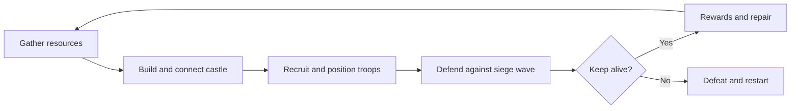

\


da123123


# MVP — Medieval Castle Siege (Working Title)

> Version: 0.1 · Target: PC / Steam · Engine: Unity (C#) · Mode: Single-player PvE first, co-op later

## 1. Product vision

A medieval castle-building and siege-defense game combining the satisfying, freeform construction feel of *Tiny Glade* with large-scale battles inspired by *Diplomacy Is Not an Option*. Players build a distinctive fortress, establish a small resource economy, recruit defenders, and survive enemy assaults.

**Core promise:** **Build a beautiful castle → prepare defenses → watch an epic siege → repair and improve.**

The MVP must validate whether this loop is enjoyable, readable, and technically stable. It is **not** the complete multiplayer kingdom simulator.

## 2. Scope and success criteria

### In scope (MVP)

- One playable map, one medieval biome, one starting scenario.
- Freeform wall placement, corner/connection handling, one tower type, one gate type.
- Simple building placement: house, lumber camp, quarry, barracks, storage (or equivalent).
- Three resources: wood, stone, food; abstract or automated collection.
- One population/capacity mechanic and one recruitment mechanic.
- Two friendly troop types: melee and ranged.
- Two enemy types: melee attacker and siege/breacher.
- Basic troop orders: select, move, attack-move/attack target; defend position.
- One wave-based PvE siege scenario with 5 escalating waves.
- Enemies target a valid route through gates or destroy obstructing walls when needed.
- Walls/gates/towers have HP and visible damage/destruction states.
- Simple HUD: resources, population, build menu, troop controls, wave countdown, victory/defeat.
- Save/load a local run (if implementation time allows; see priority).
- Performance instrumentation for unit count, FPS, simulation time, memory, network-independent gameplay.

### Out of scope (MVP)

- PvP, ranked play, matchmaking, dedicated servers.
- Co-op networking in the **first validation milestone**; architect to add it after the solo loop is proven.
- Large technology tree, diplomacy, trade, quests, campaign, multiple factions.
- Fully simulated individual citizens, elaborate logistics, advanced weather/seasons.
- Unlimited procedural terrain, multiple maps, cosmetic asset catalog.
- Thousands of unique unit animations or full-scale destruction physics.

### Non-negotiable design constraints

1. Construction is intuitive and visually rewarding, not a CAD tool.
2. A wall must have gameplay value; attackers must interact with fortifications.
3. Combat remains legible at a zoomed-out RTS camera distance.
4. Core simulation must be independent from visual presentation and multiplayer transport.
5. Prefer deterministic, bounded rules over feature breadth.

## 3. Target player and experience

- Players who enjoy creative medieval building, base defense, and spectacular mass battles.
- Session goal: **20–35 minutes** for one complete defense run in the MVP.
- Camera: top-down/isometric free orbit and zoom.
- Controls: mouse + keyboard; left click select/place, right click order, WASD/edge pan, scroll zoom, rotate camera.
- Art direction: cohesive stylized low-poly / diorama medieval world; readable silhouettes, restrained materials, warm lighting.

## 4. Core gameplay loop



### Win and lose

- **Victory:** survive wave 5 with the Keep/Core intact.
- **Defeat:** Keep/Core HP reaches zero.
- **Between waves:** short preparation window to rebuild and recruit.

## 5. Minimum mechanics

### 5.1 Castle construction

- Place walls by selecting start/end points; preview the segment and show costs before confirmation.
- Snap/merge adjoining segments; auto-generate clean corners and intersections.
- Place tower and gate on valid attachment points.
- Block placement on occupied/invalid terrain; allow cancel, remove, and refund (configurable percentage).
- Construction costs wood/stone and completes immediately for MVP.
- Destruction updates colliders, visual mesh, and navigability without long simulation stalls.

**Acceptance:** a tester can build a closed enclosure with a gate and two towers in under 5 minutes without instruction.

### 5.2 Economy and recruitment

- Wood and stone accumulate from simple producer buildings on fixed intervals.
- Food supports unit upkeep/capacity in a simplified rule; no individual food transport.
- Houses raise population cap; barracks trains melee/ranged troops using a short queue.
- Resources are spent on placement, repairs, and troop recruitment.

**Acceptance:** the player understands why they cannot afford a build or troop and how to fix it.

### 5.3 Combat and siege

- Units have HP, movement speed, attack damage, range, cooldown, faction.
- Friendly units can be selected as a group and ordered to move/attack/hold.
- Enemy wave spawns from 1–2 predetermined map edges.
- Enemy prioritizes Keep; seeks traversable paths; when blocked, breachers damage the nearest suitable gate/wall section.
- Ranged units attack from valid range; basic line-of-sight may be simplified initially.
- Towers offer defensive positions or automated attacks (choose one implementation for MVP).
- Death effects are lightweight and pooled; avoid per-unit rigidbody destruction.

**Acceptance:** a player can influence wave outcomes through wall layout and unit positioning, not just total troop count.

### 5.4 Waves

| Wave | Intent                  | New pressure               |
| ---- | ----------------------- | -------------------------- |
| 1    | Tutorial through play   | Small melee raid           |
| 2    | Test wall placement     | More attackers             |
| 3    | Test gate defense       | First breachers            |
| 4    | Force tactical response | Multiple attack directions |
| 5    | Final challenge         | Large mixed siege          |

All numbers are data-driven and tuned through playtests; no unverified fixed balance numbers.

## 6. Technical architecture (Unity)

### 6.1 Modules

```text
Game/
  Core/             GameState, Time, Events, Config
  Construction/     BuildInput, Preview, WallGraph, ProceduralMesh, BuildValidation
  Economy/          ResourceStore, Producers, Population, RecruitQueue
  Combat/           UnitSimulation, Orders, Targeting, Damage, SiegeAI
  Navigation/       PathRequest, GroupFlowField, ObstacleUpdates
  Waves/            WaveDirector, SpawnPoints, VictoryConditions
  Presentation/     UnitViews, VFX, SFX, Camera, HUD
  Persistence/      SaveData, Serializer (P1)
  Networking/       Reserved interfaces, no transport dependency in MVP
  Tests/            PlayMode, EditMode, Performance
```

- **Unity URP** for rendering.
- **Unity Entities/ECS + Burst + Jobs** for high-volume unit simulation if the existing 40,000-unit prototype already uses it effectively. Do not rewrite working simulation without a benchmarked reason.
- **Procedural meshes / Unity Splines** for walls and joins; store the editable wall graph as source data, not only the generated mesh.
- **Hybrid navigation:** group/flow-field approach for crowds, lightweight local avoidance. Unity AI Navigation may be useful for limited agents but should not be assumed sufficient for tens of thousands of units.
- **Object pooling, instancing, LOD/culling** for scalable visual units.
- **FishNet + EOS** are candidate technologies for a later co-op phase, **not required for solo MVP**. EOS requires compatible networking/transport integration; FishNet does not automatically sync ECS entities.

### 6.2 Data model

- `BuildingDefinition`: ID, cost, HP, footprint, placement rules, production.
- `WallSegmentData`: endpoints, height/type, HP, connectivity, gate/tower attachments.
- `UnitDefinition`: faction, HP, speed, attack, range, cost, visuals.
- `WaveDefinition`: enemy composition, spawn points, delay, rewards.
- `GameBalanceConfig`: costs, timers, difficulty multipliers.

### 6.3 Important separation

**Authoritative game state** (resource counts, building graph, HP, unit positions/orders, waves) must not depend on meshes, animations, HUD, or sound. This makes save/load, testing, and future multiplayer adaptation easier.

## 7. Performance targets and benchmarks

> The existing 40,000-unit combat prototype is an important starting asset, **not proof that the integrated game supports 40,000 fully active agents**.

| Test             | Initial target                                                          |
| ---------------- | ----------------------------------------------------------------------- |
| Target platform  | Mid-range Windows PC, 1080p                                             |
| Typical battle   | 1,000–3,000 active units, stable 60 FPS on chosen test hardware        |
| Stress test      | 10,000+ units, measured and reported separately                         |
| 40,000-unit test | Preserve as a separate benchmark; record what is simulated and rendered |
| Build update     | No noticeable multi-second stall on placing/removing a wall             |
| Memory           | No uncontrolled growth over a full 30-minute run                        |

Targets are provisional until actual hardware and profiling data are recorded. Capture CPU main thread, ECS systems, rendering, memory, navigation updates, and GC allocations. Record unit counts separately for **rendered**, **moving**, **pathfinding**, **targeting**, and **actively fighting** units.

## 8. UX and asset requirements

- One cohesive UI style: readable at 1080p, consistent icons and tooltips.
- Art bible: medieval diorama, consistent scale, palette, edge treatment, and lighting.
- Required assets only: terrain set, Keep, 5 economic/utility buildings, walls/gate/tower, 4 troop silhouettes, minimal VFX and SFX.
- AI-generated or free assets must have documented commercial-use rights before release; free access alone is not proof of licensing.
- Placeholder assets are acceptable until the loop is validated.

## 9. Milestones and priorities

| Phase                         | Priority | Deliverable                                                | Exit gate                                            |
| ----------------------------- | -------- | ---------------------------------------------------------- | ---------------------------------------------------- |
| M0: Audit existing prototypes | P0       | Building + combat demo assessed, dependencies mapped       | Both run in the same target Unity version            |
| M1: Integrate                 | P0       | Buildable walls + unit movement + destructible obstruction | Units respond to wall/gate placement and destruction |
| M2: Game loop                 | P0       | Economy + recruitment + 5 siege waves                      | Complete win/lose run without debug commands         |
| M3: Usability                 | P0       | HUD, feedback, onboarding, sound placeholders              | New tester finishes a run without developer coaching |
| M4: Stability                 | P0       | Profiling, bug fixing, packaged Windows build              | No blocker bugs in repeated full runs                |
| M5: Extras                    | P1       | Save/load, visual polish, optional extra units             | Only after M0–M4 pass                               |
| M6: Co-op spike               | Post-MVP | Two-player synchronized prototype                          | State consistency under latency and disconnects      |

**Suggested order:** prove construction–navigation interaction before adding content; this is the highest integration risk.

## 10. Definition of done (MVP)

- [ ] Fresh Windows build launches without editor or developer tools.
- [ ] Player can build walls, gates, towers, and essential buildings.
- [ ] Resource generation, spending, recruitment, and repair function.
- [ ] Units obey group commands and interact correctly with obstacles.
- [ ] Enemies breach defenses and attack the Keep.
- [ ] Five waves produce a complete 20–35-minute run.
- [ ] Victory, defeat, restart, pause, and essential settings work.
- [ ] UI explains controls, costs, and key warnings.
- [ ] Three external testers can play a full run; major confusion points are documented and fixed.
- [ ] Performance metrics are captured on named test hardware.
- [ ] No known crash or save-corruption blocker (if save/load is included).

## 11. Risks and mitigations

| Risk                            | Why it matters                  | Mitigation                                                               |
| ------------------------------- | ------------------------------- | ------------------------------------------------------------------------ |
| Freeform walls break navigation | Core feature collision          | Central wall graph, incremental obstacle updates, regression tests       |
| Crowd pathfinding scales poorly | Large battles become unplayable | Group paths/flow fields, bounded updates, profiling                      |
| Construction becomes fiddly     | Main selling point loses appeal | Snap previews, undo/remove, rapid usability tests                        |
| AI assets look inconsistent     | Lowers perceived quality        | Art bible and a small curated asset set                                  |
| Multiplayer scope creep         | Delays shipping indefinitely    | Solo PvE first, network interfaces isolated, co-op spike after MVP       |
| Siege AI is too simplistic      | Walls feel cosmetic             | Breach behavior and tactical counterplay as P0                           |
| Marketing starts too late       | No audience at launch           | Capture GIFs of castle creation + siege early; test concept with players |

## 12. After MVP (not promised in first release)

1. **Co-op PvE:** 2–4 players jointly build and defend one kingdom; server/host-authoritative state, reconnection policy, synchronization benchmarks.
2. **PvP:** 1v1 first, with balance and anti-cheat requirements; consider 2v2 only after validation.
3. Additional siege weapons, biomes, factions, progression, workshop/blueprint sharing.
4. Steam page, public demo, wishlists, community playtests, launch planning.

## 13. Open decisions

- Is the first public demo **solo PvE** or **2-player co-op PvE**? This document defaults to solo to reduce risk.
- Is the castle builder gridless with curves everywhere, or straight segments with visually smoothed joins in the MVP? Default: straight segments + smooth joins.
- Are towers automated defenses or garrison positions? Choose one for MVP.
- What are the minimum and recommended PC hardware targets?
- How many units can the existing 40,000-unit prototype **move, pathfind, target, and fight simultaneously**?
- How reusable are the current building and combat prototypes in one Unity project?

---

**Scope rule:** Any feature not necessary to prove “build → defend → repair” goes to the backlog until the MVP passes its definition of done.
