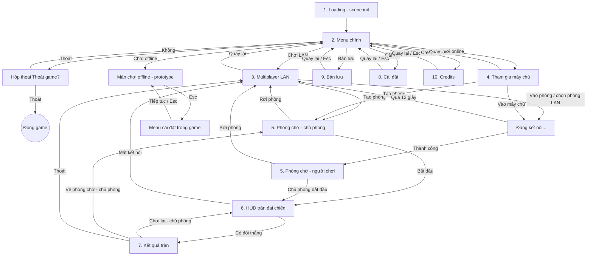

# Wireframe toàn bộ giao diện Survival RTS (để vẽ lại trên Figma)

Tài liệu mô tả mọi màn hình, kích thước, vị trí, màu, chữ và luồng chuyển màn đang có trong Unity. Cuối file có sẵn prompt dán cho AI Figma.

Quy ước: tọa độ tính từ **góc trên trái** của frame, đơn vị px. Frame chuẩn **1920 × 1080** cho luồng mới (loading, menu, multiplayer, trận đại chiến). Giao diện cũ trong màn chơi offline (`prototype`) dùng frame **1440 × 810** và nền tối, ghi riêng ở mục 6.

---

## 1. Design tokens (theme wireframe xám sáng)

| Token | Hex | Dùng cho |
|---|---|---|
| Screen | `#E8E8E8` | Nền màn Loading, Cài đặt, Bản lưu, Credits |
| World | `#C6C6C6` | Nền màn Menu chính, Multiplayer, Phòng chờ (ô "HÌNH NỀN") |
| Panel | `#FAFAFA` | Nền thẻ/panel, ô nhập chữ |
| Row | `#DADADA` | Nền nút thường, dòng danh sách, ô giữ chỗ |
| Border | `#808080` | Viền panel, viền nút |
| Separator | `#C0C0C0` | Đường kẻ 2px |
| Ink | `#262626` | Chữ chính |
| Dim | `#6C6C6C` | Chữ phụ, ghi chú, placeholder |
| Primary | `#505050` | Nền nút chính (chữ `#FAFAFA`), phần đã chọn của thanh trượt/tiến trình `#686868` |
| Backdrop | `#262626` alpha 45% | Lớp mờ phía sau hộp thoại / màn kết quả |

Trạng thái nút thường: hover nền `#C6C6C6` viền `#505050`, nhấn nền `#A8A8A8` viền `#262626`, vô hiệu nền `#E3E3E3` viền `#C0C0C0` chữ Dim 60%.
Trạng thái nút chính: hover `#3D3D3D`, nhấn `#262626`, vô hiệu `#9E9E9E`.

- Viền **2px**. Bo góc: panel **6px**, nút/ô nhập/placeholder **4px**.
- Font: **Liberation Sans** (tiếng Việt có dấu). Cỡ chữ dùng: 14, 16, 18, 20, 22, 24, 26, 28, 30, 32, 44.
- Ô giữ chỗ (logo, hình nền): nền Row, viền Border, chữ Dim, căn giữa.
- Heading: chữ cỡ 30–32 + đường kẻ Separator 2px bên dưới, cách 8px.
- Màu đội (ô vuông màu): lấy từ `BattleData.teamColors` (4 màu khác nhau; Figma dùng đỏ/xanh dương/xanh lá/vàng cho dễ phân biệt).

Thành phần dùng lại:

| Thành phần | Kích thước | Ghi chú |
|---|---|---|
| Nút lớn menu | rộng theo cột × 56, chữ 24 | Nút chính có nền Primary |
| Nút thường | 48 cao (footer 52), chữ 20 | Rộng thường 110–190 |
| Ô nhập | cao 44–48, padding chữ 12 | Placeholder italic Dim |
| Dòng cài đặt | cao 56 | Tên trái (chữ 20), điều khiển phải, đường kẻ 2px dưới đáy |
| Thanh trượt | 320 × 32 | Rãnh cao 14, núm 20 × 32, nhãn giá trị 90px bên phải |
| Nút Bật/Tắt | 120 × 40 | "Bật" đậm Ink / "Tắt" thường Dim |
| Chọn giá trị | nút `<` 44×40, nhãn 220 căn giữa, nút `>` 44×40 | Xoay vòng |
| Tab | 180 × 44, cách 8 | Tab đang chọn dùng kiểu nút chính |
| Ô màu đội | 20–30 vuông | Cạnh tên đội |

---

## 2. Sơ đồ luồng màn hình



Ghi chú luồng:
- Quay lại từ Multiplayer về Menu: tự rời phòng nếu đang kết nối.
- Màn "Đang kết nối" không phải màn riêng: dòng trạng thái (cỡ 18, căn giữa) trên màn Multiplayer/Máy chủ đổi thành "Đang kết nối tới …". Quá 12 giây hiện thông báo "Không kết nối được tới phòng".
- Mất kết nối giữa trận: quay về màn Multiplayer, dòng trạng thái hiện "Mất kết nối: …".
- Màn Multiplayer LAN và Tham gia máy chủ là **cùng một scene**, chỉ khác nội dung theo chế độ chọn ở Menu.

---

## 3. Luồng vào game

### 3.1 Loading (scene `init`) — nền Screen

```
+--------------------------------------------------------------+
|                                                              |
|                    +-----------------------+                 |
|                    |   LOGO (placeholder)  | 480x200         |
|                    |      SURVIVAL RTS     |                 |
|                    +-----------------------+                 |
|             Mẹo: Lính cung đứng sau lính kiếm... (900x60)     |
|                                                              |
|  [=========================------------------]  thanh 24 cao |
|  Nạp âm thanh...                                       45%   |
+--------------------------------------------------------------+
```

| Phần tử | Vị trí / kích thước |
|---|---|
| Nền | full 1920×1080, Screen |
| Nhóm giữa | 900 × 360, tâm màn hình dịch **lên 50px** (tâm y = 490), dọc, cách 48px, căn giữa trên |
| Ô logo | 480 × 200, chữ "SURVIVAL RTS" cỡ 44 |
| Mẹo chơi | 900 × 60, chữ 20 căn giữa, đổi mỗi 3 giây |
| Chân trang | rộng 1920−240 = 1680 (lề trái/phải 120), cao 70, đáy cách mép dưới 80 → x=120, y=930 |
| Thanh tiến trình | trong chân trang, cao 24, rãnh Row viền Border, phần tô `#686868` cách mép trong 4px |
| Hàng trạng thái | dưới thanh, cách 12, cao 30: trạng thái trái (18, Dim), phần trăm phải rộng 120 (18, Dim, căn phải) |

Trạng thái chữ lần lượt: "Khởi tạo hệ thống...", "Nạp thành phần mạng...", "Nạp âm thanh...", "Nạp dữ liệu trận...", "Nạp màn chơi...", "Sẵn sàng". Tự chuyển sang Menu khi đầy 100%.

### 3.2 Menu chính (scene `menu`) — nền World

```
+--------------------------------------------------------------+
|                                                              |
|  +----------------+      (vùng HÌNH NỀN - chữ Dim cỡ 28,     |
|  | LOGO  176 cao  |       căn giữa vùng x từ 520 đến 1920)    |
|  +----------------+                                          |
|  [ Chơi offline ]  <- nút chính                              |
|  [ Chơi LAN     ]                                            |
|  [ Chơi online  ]                                            |
|  [ Bản lưu      ]                                            |
|  [ Cài đặt      ]                                            |
|  [ Credits      ]                                            |
|  [ Thoát        ]                                            |
|  v0.1                                                        |
+--------------------------------------------------------------+
```

| Phần tử | Vị trí / kích thước |
|---|---|
| Sidebar | x=80, rộng 380, cao 800 (1080−280), **dịch xuống 60** → y từ 200 đến 1000; dọc, cách 12 |
| Ô logo | 380 × 176, chữ "SURVIVAL RTS" cỡ 30 |
| Khoảng trống | 8px dưới logo |
| 7 nút | 380 × 56, chữ 24, thứ tự: Chơi offline (**chính**), Chơi LAN, Chơi online, Bản lưu, Cài đặt, Credits, Thoát |
| Chân sidebar | khoảng đệm linh hoạt rồi chữ "v0.1" cỡ 14 Dim, cao 22 |
| Ô "HÌNH NỀN" | chữ cỡ 28 Dim căn giữa trong vùng x ≥ 520 |

Hộp thoại **Thoát game?** (hiện khi bấm Thoát):
- Lớp mờ Backdrop phủ cả màn hình.
- Panel 560 rộng, cao tự động, căn giữa; padding 20, cách 20.
- Heading "Thoát game?" (cỡ 32 + đường kẻ). Nội dung "Tiến trình chưa lưu sẽ bị mất." cỡ 20, cao 56.
- Hàng nút căn phải cao 48, cách 12: **Không** 140×48, **Thoát** 140×48 (nút chính).

---

## 4. Multiplayer

### 4.1 Multiplayer LAN — nền World

Panel giữa màn hình: rộng **640**, cao tự động (~480), padding 24, cách 16, nền Panel, viền Border.

| Thứ tự | Phần tử | Kích thước |
|---|---|---|
| 1 | Heading "Đại chiến 4 đội - LAN" | cỡ 30 |
| 2 | Nút **Tạo phòng** (chính) | rộng đầy, cao 56, chữ 22 |
| 3 | Hàng vào phòng | cao 48, cách 12: ô nhập (giãn, placeholder "Địa chỉ IP hoặc IP:cổng", mặc định `127.0.0.1`) + nút **Vào phòng** 170×48 |
| 4 | Nhãn "Phòng trong mạng LAN" | cỡ 18 Dim, cao 26 |
| 5 | Danh sách phòng | dọc, cách 8. Mỗi phòng là nút cao 44, chữ 18: `Tên máy  (n/4)  192.168.x.x`. Tối đa 6. Trống: ô giữ chỗ cao 48 "Chưa thấy phòng nào" |
| 6 | Dòng trạng thái | cao 30, chữ 18 căn giữa (hiện "Đang kết nối...", thông báo lỗi) |
| 7 | Đường kẻ + hàng hành động | cao 48: **Quay lại** 160×48 (trái) |

### 4.2 Tham gia máy chủ (chế độ Online) — nền World

Giao diện kiểu "Join Server": danh sách máy chủ người chơi tự lưu (tối đa 8, nhớ qua lần mở sau).

```
+------------------------------------------------------------------+
| Tham gia máy chủ                                                  |
| ----------------------------------------------------------------- |
| Tên máy chủ                       Địa chỉ                         |
| [ Server của Long                  203.0.113.5:7770          ]    |  <- dòng được chọn: nút chính
| [ Server bạn bè                    198.51.100.7              ]    |
| ----------------------------------------------------------------- |
| [ Tên máy chủ     ] [ Địa chỉ IP hoặc IP:cổng     ] [ Thêm ]     |
| Chưa có máy chủ trung tâm: nhập IP công khai ... (16, Dim)        |
|                           (trạng thái)                            |
| ----------------------------------------------------------------- |
| [Quay lại]                        [Xoá] [Tạo phòng] [Vào máy chủ] |
+------------------------------------------------------------------+
```

| Phần tử | Kích thước |
|---|---|
| Panel | rộng **860**, cao tự động, căn giữa, padding 24, cách 12 |
| Heading "Tham gia máy chủ" | cỡ 30 |
| Hàng tiêu đề cột | cao 28, hai cột bằng nhau "Tên máy chủ" và "Địa chỉ", chữ 18 Dim |
| Dòng máy chủ | nút cao 44, chữ 18, căn trái, cách 6; dòng chọn = nút chính. Trống: ô giữ chỗ cao 56 "Chưa có máy chủ nào, hãy thêm bên dưới" |
| Hàng thêm | cao 48, cách 10: ô tên (giãn), ô địa chỉ (giãn), nút **Thêm** 110×48 |
| Ghi chú | cao 44, chữ 16 Dim, 2 dòng |
| Trạng thái | cao 28, chữ 18 căn giữa |
| Hàng hành động | cao 52, cách 12: **Quay lại** 150×52 (trái), khoảng đệm, **Xoá** 110×52, **Tạo phòng** 160×52, **Vào máy chủ** 190×52 (chính, mờ khi chưa chọn dòng) |

Về sau (nếu thêm dịch vụ tìm phòng như Steam/Unity Lobby): thay các dòng tự lưu bằng danh sách phòng thật với cột Tên / Số người (n/4) / Ping, thêm nút **Làm mới**; giữ mục "Kết nối trực tiếp" cho nhập IP.

### 4.3 Phòng chờ — nền World

Panel giữa, rộng **640**, cao tự động (~520), padding 24, cách 14.

| Thứ tự | Phần tử | Kích thước |
|---|---|---|
| 1 | Heading "Phòng chờ" | cỡ 30 |
| 2 | Địa chỉ phòng | cao 28, chữ 18 Dim. Chủ phòng: "Địa chỉ phòng: IP1, IP2". Người vào: "Đã vào phòng của chủ phòng" |
| 3 | 4 dòng đội | mỗi dòng cao 52, nền Row, padding 14/10, cách 10: ô màu 30×30 + chữ 20 "Đội 1: Người chơi (bạn)" hoặc "Đội 2: Máy" |
| 4 | Dòng thông tin | cao 30, chữ 18 Dim: "Đội trống sẽ do máy điều khiển" (chủ phòng) / "Đang chờ chủ phòng bắt đầu..." |
| 5 | Đường kẻ + hàng hành động | cao 52, căn phải, cách 12: **Rời phòng** 170×52, **Bắt đầu** 170×52 (chính, chỉ chủ phòng thấy) |

---

## 5. Trong trận đại chiến (overlay phủ lên cảnh 3D, không có nền)

### 5.1 HUD — 1920 × 1080

```
+------------------------------------------------------------------+
| Lượt 120 | Trễ 0 lượt     (Đang chờ người chơi...)     Vàng: 400  | thanh trên 40 cao
|[Đội 1(bạn): 4000 lính]                              +-----------+ |
|[Đội 2: 4000 lính]                                   | Tiểu đội  | |
|[Đội 3: 4000 lính]                                   | Đang chọn | |
|[Đội 4: 4000 lính]                                   | [Chọn cả] | |
|                                                     | [Kiếm: ..]| |
|                                                     | [Cung: ..]| |
|                                                     | gợi ý ... | |
|                                                     +-----------+ |
|                    [Huấn luyện][Lính kiếm][Lính cung]              |
+------------------------------------------------------------------+
```

| Khối | Neo / vị trí | Kích thước & nội dung |
|---|---|---|
| Thanh trên | sát mép trên, giãn hết chiều ngang | cao **40**, nền Panel, padding 12, cách 8; ba nhãn chia đều: trái "Lượt N \| Trễ N lượt" (18), giữa "Đang chờ người chơi..." (18, chỉ khi đợi), phải "Vàng: N" (20, căn phải) |
| Bảng quân số | trái trên, cách trái 8, cách trên 48 | rộng **240**, cao tự động, padding 8, cách 4. 4 dòng cao 28: ô màu 20×20 + chữ 18 "Đội 1 (bạn): 4000 lính" |
| Thanh huấn luyện | giữa dưới, cách đáy 8 | cao tự động (~76), padding 8, cách 8: nhãn "Huấn luyện" 110×60 (18 Dim), mỗi loại lính một nút **190×60**, chữ 16 hai dòng "Lính kiếm" / "100 vàng · 5s" (mờ khi thiếu vàng) |
| Bảng tiểu đội | phải giữa, cách phải 8 | rộng **260**, cao tự động, padding 8, cách 6: "Tiểu đội" (20, cao 28); "Đang chọn: N tiểu đội" (18, cao 26); nút "Chọn cả quân (Q)" cao 36 (16); mỗi loại lính một nút cao 36 (15) "Lính kiếm: N đội · N lính"; khối gợi ý cao 100, chữ 14 Dim nhiều dòng (Kéo chuột: chọn khung / Shift: thêm vào / Nhấp đúp: cùng loại / Ctrl+1..9: gán nhóm / 1..9: gọi nhóm / Chuột phải: di chuyển) |
| Thông báo | giữa trên, cách trên 52 | **640 × 56**, nền Row, padding 12, cách: nhãn 18 (giãn) + nút **Đóng** 90×40. Chỉ hiện khi có thông báo (lệch đồng bộ, mất kết nối) |
| Vòng chọn & khung kéo | trên cảnh 3D | vẽ trực tiếp: vòng quanh tiểu đội đang chọn, khung chữ nhật khi kéo chuột |

### 5.2 Kết quả trận — phủ lên HUD

- Lớp mờ Backdrop phủ cả màn hình.
- Panel giữa, rộng **700**, cao tự động (~520), padding 24, cách 12.

| Thứ tự | Phần tử | Kích thước |
|---|---|---|
| 1 | Heading | cỡ 32: "Bạn thắng!" / "Đội N thắng" / "Trận kết thúc" |
| 2 | Hàng tiêu đề cột | cao 40, nền Panel: khoảng trống 24 + 4 cột chia đều "Đội \| Còn sống \| Đã hạ \| Đã mất" (20 Dim, cột 1 căn trái, còn lại căn giữa) |
| 3 | 4 dòng đội | cao 40, nền Row, padding 10/6, cách 10: ô màu 24×24 + 4 ô chữ 20 |
| 4 | Ghi chú | cao 28, chữ 18 Dim căn giữa: "Chờ chủ phòng chọn..." (người chơi thường), trống với chủ phòng |
| 5 | Đường kẻ + hàng hành động | cao 52, căn phải, cách 12: **Thoát** 130×52, **Về phòng chờ** 190×52, **Chơi lại** 150×52 (chính). Hai nút sau mờ nếu không phải chủ phòng |

---

## 6. Màn hình phụ (từ Menu, cùng kiểu "thẻ lớn")

Khung chung (hàm `ScreenCard`): nền Screen phủ cả màn hình; **thẻ** Panel viền Border bo 6, lề cách mép màn hình **marginX / marginY**, padding 24, cách 16.
Bên trong, từ trên xuống: **Header** cao 48 (tiêu đề cỡ 32 trái, ghi chú cỡ 14 Dim phải rộng 320, căn đáy) → đường kẻ 2px → nội dung → đường kẻ → **Footer** cao 52.

### 6.1 Cài đặt — thẻ lề 180 / 48 (thẻ 1560 × 984, x=180, y=48)

- Header: "Cài đặt" — ghi chú "Cài đặt · Đồ họa" (đổi theo tab).
- Hàng tab (cao 48): 3 nút 180×44 cách 8 — **Đồ họa**, **Âm thanh**, **Điều khiển**; tab đang chọn là nút chính. Dưới có đường kẻ.
- Vùng nội dung cuộn dọc, giãn hết chỗ còn lại, cách 20 giữa các nhóm. Tiêu đề nhóm cỡ 24, cao 40.
- Footer: **Mặc định** 160×48 (trái), khoảng đệm, **Quay lại** 160×48, **Áp dụng** 160×48 (chính).

Tab **Đồ họa**
- Nhóm "Hiển thị màn hình": Độ phân giải (chọn `<` `>`, ví dụ "1920 x 1080"), Toàn màn hình (Bật/Tắt), Đồng bộ dọc (VSync) (Bật/Tắt), Giới hạn FPS (30 / 60 / 120 / 144 FPS / Không giới hạn).
- Nhóm "Chất lượng": Chất lượng đồ họa (chọn theo danh sách mức chất lượng Unity).

Tab **Âm thanh**
- Nhóm "Âm lượng các kênh (%)": 4 thanh trượt 0–100 kèm nhãn %: Âm lượng tổng (Master), Nhạc nền, Hiệu ứng thế giới (SFX), Âm thanh giao diện (UI).

Tab **Điều khiển** (chỉ xem)
- Nhóm "Điều khiển trong trận đại chiến": 6 dòng tên trái / phím phải (18 Dim): Chọn tiểu đội — Kéo chuột trái, Shift để thêm; Chọn cùng loại — Nhấp đúp; Chọn cả quân — Q; Gán nhóm — Ctrl + 1..9; Gọi nhóm — 1..9; Di chuyển — Chuột phải.
- Dòng ghi chú cuối: "Chưa hỗ trợ đổi phím." (16 Dim).

### 6.2 Bản lưu — thẻ lề 180 / 48

- Header: "Danh sách bản lưu" — ghi chú "Bản lưu · 0 / 6".
- Nội dung (cuộn): trống thì có **ô trống** nền Row cao 150, chữ 18 Dim 2 dòng căn giữa: "Chưa có bản lưu nào (0 / 6)." / "Chức năng lưu game sẽ được thêm sau.". Có bản lưu thì mỗi bản là một dòng cao 64 nền Row, padding 10, cách 12: tên + ngày giờ (20, giãn) + nút **Xoá** 110×44. Tối đa 6 dòng.
- Footer: chữ trạng thái 16 Dim (giãn) "Tối đa 6 bản lưu" + **Quay lại** 160×48.

### 6.3 Credits — thẻ lề 480 / 110 (thẻ 960 × 860, x=480, y=110)

- Header: "Credits" — ghi chú "Survival RTS".
- Nội dung căn giữa dọc, cách 24: ô huy hiệu giữ chỗ **220 × 84** (chữ "SURVIVAL RTS" 24, căn giữa ngang); dòng "Công nghệ sử dụng trong game" cỡ 26 căn giữa cao 40; 3 dòng cao 84: bên trái (tên cỡ 20 + mô tả cỡ 15 Dim) bên phải nút **Mở trang chủ** 190×44, đường kẻ 2px dưới mỗi dòng. Ba dòng: Unity 6, FishNet, TextMeshPro.
- Footer: "Nhấn vào nút để mở trên trình duyệt" (16 Dim, giãn) + **Quay lại** 160×48.

---

## 7. Giao diện cũ trong màn chơi offline (scene `prototype`) — frame **1440 × 810**, nền **tối**

Đây là giao diện đã làm trước theme sáng. Khi vẽ Figma có thể vẽ bản tối như thật hoặc đổi sang bảng màu mục 1 để đồng nhất (khuyến nghị đổi).

Màu tối đang dùng: Panel `#242424` (95%), Card `#383838`, Track `#1A1A1A`, Border `#7A7A7A`, chữ chính `#F5F5F5`, chữ phụ `#C7C7C7`, nút nhấn `#E6E6E6` chữ `#141414`. Viền 1px (Outline), không bo góc.

| Màn | Vị trí / kích thước | Nội dung |
|---|---|---|
| **Thanh tài nguyên** | góc phải trên, cách phải 16, cách trên 14; hàng ngang cách 8 | 6 ô, mỗi ô tối thiểu **108 × 42**, padding 8/12/6/6: ô icon 26×26 + 2 dòng chữ (nhãn 10.5 đậm Dim, giá trị 15 đậm). Thứ tự: DÂN SỐ (0 / 0), TIỀN, LÚA, GỖ, ĐÁ, SẮT |
| **Bản đồ nhỏ** | góc trái dưới, cách trái 16, cách đáy 16 | 170 × 170 |
| **Bản đồ lớn** | giữa màn hình, lệch lên 36 | 460 × 460, mặc định ẩn |
| **Bảng xây dựng** | giữa dưới, cách đáy 16, cao tự động | rộng tối thiểu 480, padding 12/12/8/12, cách 8. Hàng đầu cao 20: "XÂY DỰNG" (13.5 đậm), "Dân rỗi: 0/0 · Thợ xây: 0" (12.5 Dim, giãn), "Chuột trái đặt · Chuột phải hủy" (12 Dim, phải). Hàng tab cao 28 cách 6: mỗi tab padding 10/4, chữ 12.5 + ô đếm số (11.5). Danh sách thẻ cao 120 cách 8: thẻ **106 × 120** gồm ô xem trước 94×46 (ô footprint 24×24), tên (12.5 đậm), kích thước "2x2" (11 Dim), giá (11.5 đậm). Trống: "Chưa có công trình nào trong nhóm này" cao 110. Thanh đặt (cao 32, chỉ khi đang đặt): nhãn "Đang đặt" + **Xoay 90°** 86×26 + **Xác nhận phá** 112×26 + **Hủy** 68×26 |
| **Thanh máu công trình** | đi theo vật thể trong cảnh, neo giữa dưới | thanh **144 × 18** (phần tô `#BFBFBF`, chữ "0 / 0" giữa); ô trạng thái phía trên (11.5 đậm); panel thợ: nút `-` 26×22, "Thợ: 0/3", nút "+ Thợ" 60×22; panel tháo dỡ: **Tháo dỡ** 70×22, "Phá (2.5s)?", **Xác nhận phá** 96×22, **Hủy** 50×22 |
| **Lệnh lính** | giữa dưới, cách đáy 245 | panel ngang padding 12/8 cách 10: tên (14 đậm, "Lính kiếm"), trạng thái (12.5 Dim, "Đang canh gác trước trại"), **Di chuyển** 88×30, **Về trại** 78×30, **Hủy** 62×30 (ẩn mặc định) |
| **Menu Esc (tạm dừng)** | phủ cả màn hình, lớp đen 60% | panel giữa rộng 440, cao tự động, padding 22/18/20, cách 8: "CÀI ĐẶT" (20 đậm giữa), "ÂM THANH" (12.5 Dim), 4 dòng thanh trượt cao 40 (nhãn 100px: Tổng / Nhạc nền / Hiệu ứng / Giao diện; thanh trượt giãn cao 20; nhãn % rộng 46), hàng nút phải cao 40: **Mặc định** 104×34, **Tiếp tục** 104×34 (sáng); gợi ý "Esc để đóng · Game tạm dừng khi menu mở" (11.5 Dim) |

Luồng: Chơi offline → màn chơi; **Esc** mở Menu Esc (game tạm dừng); **Tiếp tục** hoặc Esc đóng. Esc khi đang đặt công trình/mở bản đồ lớn chỉ hủy thao tác đó.

---

## 8. Prompt dán cho AI Figma

> Hãy vẽ bộ wireframe cho game chiến thuật "Survival RTS" trong Figma, theo tài liệu dưới. Phong cách wireframe xám sáng, không màu mè, ưu tiên layout chuẩn. Dùng **Auto Layout** cho mọi nhóm, đặt tên layer theo tên phần tử, và tạo **Components** cho: Nút thường, Nút chính, Ô nhập, Dòng cài đặt, Thanh trượt, Nút Bật/Tắt, Chọn giá trị `< >`, Tab, Ô giữ chỗ, Heading, Panel, Ô màu đội.
>
> **Style**: tạo Color Styles theo bảng token mục 1 (Screen #E8E8E8, World #C6C6C6, Panel #FAFAFA, Row #DADADA, Border #808080, Separator #C0C0C0, Ink #262626, Dim #6C6C6C, Primary #505050). Viền 2px, bo góc 6 (panel) và 4 (nút, ô nhập). Font Liberation Sans (hoặc Arial), cỡ 14–44, hỗ trợ tiếng Việt có dấu.
>
> **Frame**: 1920×1080 cho các màn mục 3–6; 1440×810 cho mục 7.
>
> **Các màn cần vẽ (mỗi màn một frame, đặt theo luồng từ trái sang phải)**: 1 Loading, 2 Menu chính, 2b Hộp thoại Thoát game, 3 Multiplayer LAN, 4 Tham gia máy chủ, 5 Phòng chờ, 6 HUD trận đại chiến, 7 Kết quả trận, 8 Cài đặt (3 frame cho 3 tab Đồ họa / Âm thanh / Điều khiển), 9 Bản lưu (trạng thái trống và có dữ liệu), 10 Credits, và các màn trong game offline ở mục 7.
>
> **Kích thước, vị trí, nội dung chữ**: lấy chính xác từ từng mục trong tài liệu (kích thước px, lề, khoảng cách, cỡ chữ, nút nào là nút chính).
>
> **Luồng**: nối bằng mũi tên theo sơ đồ mục 2, mỗi mũi tên ghi nhãn tên nút bấm (ví dụ "Chơi LAN", "Tạo phòng", "Bắt đầu", "Quay lại"). Dùng Prototype links trong Figma giữa các frame tương ứng. Màn có hai trạng thái (chủ phòng / người chơi, có / không có bản lưu) vẽ thành biến thể của cùng một component.
